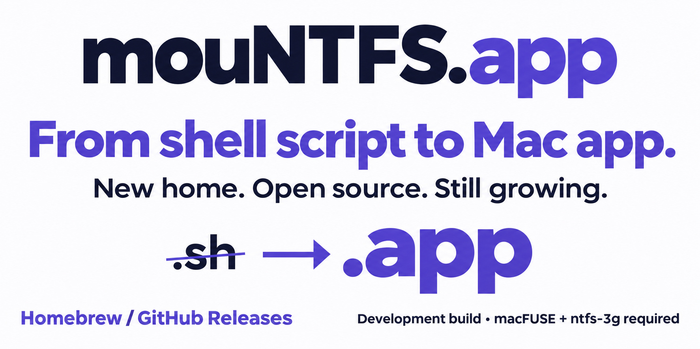

# mouNTFS 0.3.5 — The .app chapter (development)



## 新官网，新一程。

从 Shell 脚本出发，mouNTFS 已成长为原生 Mac 菜单栏应用。这次，我们也把官网从 `.sh` 升级为 **[mouNTFS.app](https://mountfs.app/zh-CN.html)**。

- **新的主场**：官网、GitHub 封面和中英文介绍统一升级，旧域名在剩余注册期内保留跳转，到期不再续费。
- **熟悉的安装方式**：通过 Homebrew tap 安装，用 `brew upgrade` 跟进后续版本；也可以直接下载本页 Assets 中的应用 ZIP。
- **看得见的开发进展**：新版官网汇集安装说明、应用界面和项目故事，Releases 持续记录版本变化。

### Homebrew 安装或更新

首次安装：

```bash
brew tap guoquan/mountfs https://github.com/guoquan/mountfs
brew install --cask guoquan/mountfs/mountfs
brew install gromgit/fuse/ntfs-3g-mac
```

已经安装：

```bash
brew update
brew upgrade --cask guoquan/mountfs/mountfs
```

本版以品牌、发布体验和 CI 工具兼容性更新为主，挂载功能沿用现有实现。仍为 **临时签名、未公证的开发构建**，需要 macOS 13+、macFUSE、ntfs-3g 及系统权限配置。权限助手与 Touch ID 界面功能继续暂停，普通挂载使用管理员授权。本版没有新增真实磁盘兼容性验证。更新前请退出旧应用。

**觉得这个项目值得继续？[给 mouNTFS 加颗星](https://github.com/guoquan/mountfs)，分享给朋友，或在 Issues 留下使用反馈。**

## A new home. A new chapter.

mouNTFS has grown from a shell script into a native Mac menu bar app. Its website now follows that journey: **[mouNTFS.app](https://mountfs.app)**.

This release brings a unified website and GitHub identity, a visible upgrade announcement, and CI compatibility fixes for current ShellCheck and Homebrew. Install from our Homebrew tap or download the Apple Silicon app ZIP below. The retiring `.sh` domain redirects only for its remaining registration period.

The mounting implementation is unchanged. This remains an **ad-hoc signed, unnotarized development build** requiring macOS 13+, macFUSE, ntfs-3g and macOS permissions. Permission-helper and Touch ID GUI features remain paused; ordinary mounting uses administrator authorization. No new physical-drive validation is claimed. Quit the old app before upgrading.

**[Star the project](https://github.com/guoquan/mountfs), share it, or help shape the next release with real-world feedback.**
